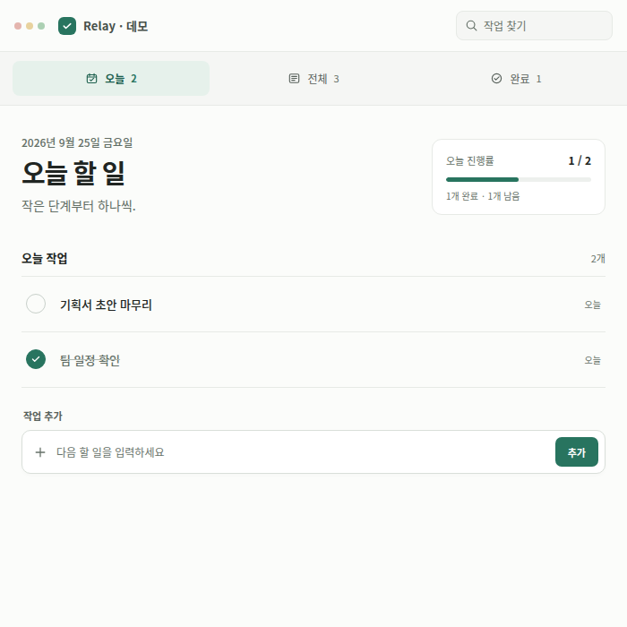

<p align="center">
  
</p>

<p align="center"><a href="README.md">한국어</a> · <b>English</b></p>

# UI/UX Skill

> **A Codex and Claude Code skill that makes the agent cover window behavior, task flow, accessibility and verification when it designs or reviews a desktop app screen.**

Based on Apple's macOS Human Interface Guidelines; the framework (SwiftUI/AppKit, Qt/QML, Flutter, web/Electron/Tauri) can be chosen later.

> **Status: a small rule set with no version number.** One `SKILL.md`, six rule modules and three demo screenshots. No tests or CI.

## Why

The skill holds the agent to four criteria: **familiar desktop behavior** (resizable windows, sidebar, toolbar, menus,
shortcuts), **short, clear copy** (labels or tooltips for ambiguous icons, error recovery kept), **complete flows** (empty,
loading, error, done, undo) and **accessibility and verification** (small window, dark mode, large text, keyboard, screen
reader, contrast, focus, reduced motion).

## How it works

`SKILL.md` holds no rules. It only says which module to read when, so the agent loads just what the current step needs.
Sizes are for the committed files, newlines included; even in bytes (3 per Korean character) every file stays under 300.

| File | Read | What the agent does | Chars | Bytes |
|---|---|---|---:|---:|
| `SKILL.md` | on invocation | Routes to the modules below | 234 | 264 |
| `macos.md` | by default | Desktop conventions, fewer deep steps and modals, system behavior | 169 | 276 |
| `research.md` | by default | Compares similar tasks on Refero, Mobbin and Uiverse; records why a pattern was chosen | 178 | 288 |
| `flow.md` | for flow design | Core task findable first; empty, loading, error, done and undo states | 108 | 258 |
| `visual.md` | for visual design | Hierarchy, consistent icons, no hover-only features, motion only to show state | 109 | 256 |
| `platforms.md` | for implementation | Technology-independent spec first, then native components; no forced HTML/CSS | 139 | 254 |
| `verify.md` | before finishing | Window sizes, themes, keyboard, screen reader, large text, contrast, focus, reduced motion; runs the core task and error recovery | 111 | 262 |

Research sources: [Apple macOS HIG](https://developer.apple.com/design/human-interface-guidelines/designing-for-macos/)
(baseline), [Refero iOS Apps](https://refero.design/ios-apps) (screen layouts), [Mobbin](https://mobbin.com/) (flows) and
[Uiverse](https://uiverse.io/) (control details). Mobile patterns are redesigned for the desktop, reference screens and assets
are never cloned, and an unreachable source is reported.

## Demo

**Relay · 데모** is a task-list demo built with the skill: today/all/completed views, search, add/complete/undo and today's
progress. The sidebar turns into tabs in narrow windows, and the demo follows system dark mode and reduced motion. Task data
lives only in page memory and resets on refresh.

<p align="center">
  
</p>
<p align="center"><sub>Default window, light mode, 1280×800.</sub></p>

<table>
  <tr>
    <td width="62%"></td>
    <td width="38%"></td>
  </tr>
  <tr>
    <td align="center"><sub>Dark mode, 1280×800.</sub></td>
    <td align="center"><sub>Narrow window, 700×700.</sub></td>
  </tr>
</table>

## Install

Both hosts read the same `name`/`description` frontmatter. `agents/openai.yaml` is only a Codex display name.

```bash
# Codex: $CODEX_HOME/skills/ui-ux-skill (default below), then add $ui-ux-skill to a request
git clone https://github.com/lsy041015/ui-ux-skill.git ~/.codex/skills/ui-ux-skill

# Claude Code, user-global (Windows: %USERPROFILE%\.claude\skills\ui-ux-skill)
git clone https://github.com/lsy041015/ui-ux-skill.git ~/.claude/skills/ui-ux-skill

# or Claude Code, project-only
git clone https://github.com/lsy041015/ui-ux-skill.git .claude/skills/ui-ux-skill
```

Claude Code lists the skill in the next session and loads it for desktop UI/UX requests; call it explicitly with
`/ui-ux-skill`. Update with `git pull` in the cloned folder.

## Usage

Example: “`$ui-ux-skill`을 사용해 할 일 관리 앱의 데스크톱 화면을 설계하고, 키보드와 작은 창 동작까지 검토해줘.”
("Design a to-do app's desktop screen and review keyboard and small-window behavior.") In Claude Code, start with `/ui-ux-skill`.

## Design notes

- Rules are checkable sentences, such as "never hide a feature behind hover alone" (`visual.md`).
- Verification means doing the core task and error recovery, and comparing captures with the requirements (`verify.md`).

## Limits

No version, changelog, tests or CI. Desktop apps only, and no output template. The research step needs the three external
sites. The demo's source code is not included.

## Credits

The four sources are only linked, with no affiliation implied; none of their screens or assets are here. The screenshots show this repository's own demo. There is no license file.

---

<p align="center"><sub>LSY.KOR · <a href="https://github.com/lsy041015">More projects</a></sub></p>
