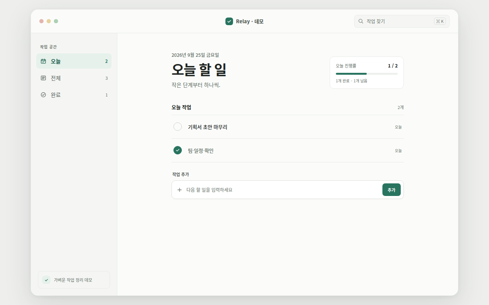
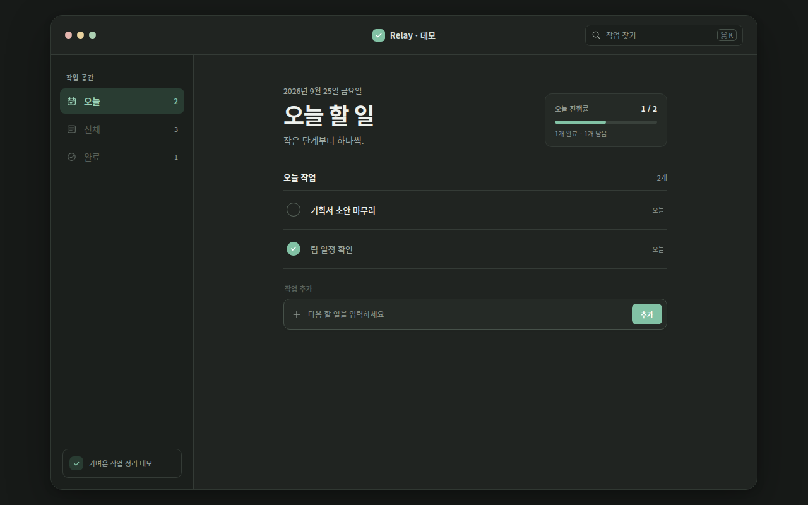

<p align="center">
  
</p>

<p align="center"><a href="README.md">한국어</a> · <b>English</b></p>

# UI/UX Skill

A small skill that makes Codex or Claude Code think about window behavior, task flow, accessibility and verification when it designs a desktop app screen.

It's based on Apple's macOS Human Interface Guidelines, and the framework (SwiftUI, Qt, Electron, whatever) can be picked later.
Instead of one long guide, the rules are split into six modules of under 300 characters each. `SKILL.md` only says which module
to read when, so the agent loads just what the current step needs. All seven files together are 1,048 characters.

- `macos.md`, `research.md` — the defaults: desktop conventions, and finding similar screens on Refero, Mobbin and Uiverse with a note on why one was picked
- `flow.md`, `visual.md` — empty, loading, error, done and undo states; hierarchy and icons. Rules are checkable, like "never hide a feature behind hover alone"
- `platforms.md` — write a technology-independent spec first, then map it to the target's native components
- `verify.md` — small windows, dark mode, large text, keyboard, screen reader, contrast, and actually doing the core task

Research happens on [Refero](https://refero.design/ios-apps), [Mobbin](https://mobbin.com/) and [Uiverse](https://uiverse.io/),
with [Apple's macOS HIG](https://developer.apple.com/design/human-interface-guidelines/designing-for-macos/) as the baseline.
Mobile screens get redesigned for the desktop, and reference screens or assets are never copied as-is.

## Demo

**Relay · 데모** is a task-list demo built with the skill. The sidebar turns into tabs in narrow windows, and it follows system
dark mode and reduced motion. Data lives only in memory, so a refresh resets it.

<p align="center">
  
</p>

<table>
  <tr>
    <td width="62%"></td>
    <td width="38%"></td>
  </tr>
</table>

## Install

The same folder works in both Codex and Claude Code.

```bash
# Codex: $CODEX_HOME/skills/ui-ux-skill (default below), then add $ui-ux-skill to a request
git clone https://github.com/lsy041015/ui-ux-skill.git ~/.codex/skills/ui-ux-skill

# Claude Code, user-global (Windows: %USERPROFILE%\.claude\skills\ui-ux-skill)
git clone https://github.com/lsy041015/ui-ux-skill.git ~/.claude/skills/ui-ux-skill

# or Claude Code, project-only
git clone https://github.com/lsy041015/ui-ux-skill.git .claude/skills/ui-ux-skill
```

Claude Code picks it up from the next session for desktop UI/UX requests, or you can call `/ui-ux-skill` directly.
To update, run `git pull` in the cloned folder.

Example: “`$ui-ux-skill`을 사용해 할 일 관리 앱의 데스크톱 화면을 설계하고, 키보드와 작은 창 동작까지 검토해줘.”
("Design a to-do app's desktop screen and review keyboard and small-window behavior.")

## Rough edges

No version number or tests, and the demo's source isn't in the repo (just the screenshots). The research step needs the three
external sites; if they can't be reached, the agent just says so. There's no license file.

<sub>[More projects](https://github.com/lsy041015)</sub>
