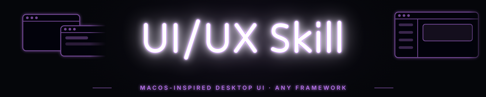
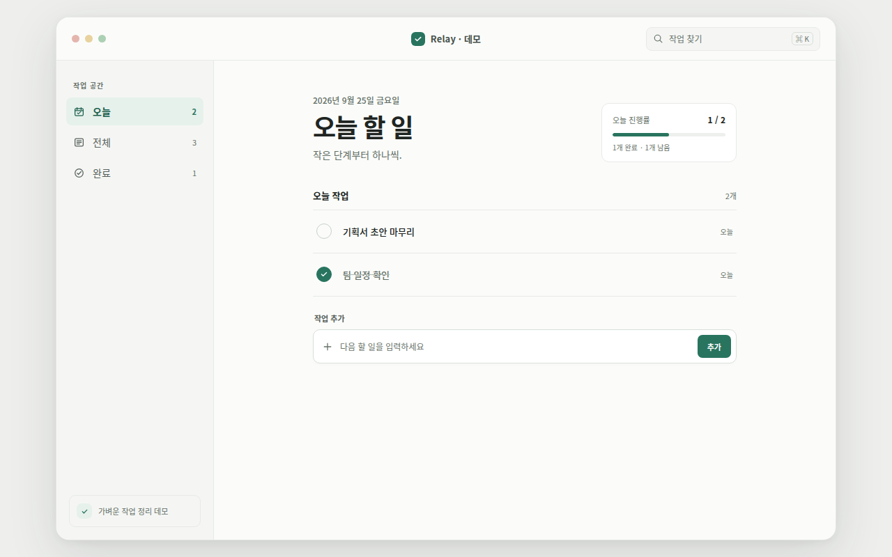
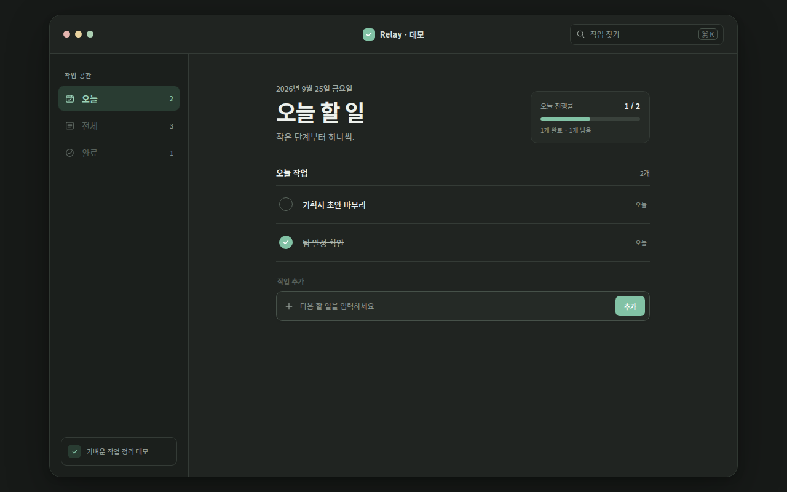
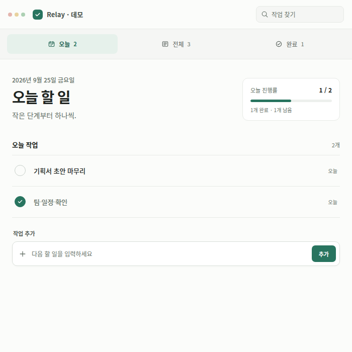

<p align="center">
  
</p>

<p align="center"><b>한국어</b> · <a href="README.en.md">English</a></p>

# UI/UX Skill

> **Codex나 Claude Code에게 데스크톱 앱 화면을 맡길 때, 창 동작·작업 흐름·접근성·검증까지 함께 챙기게 하는 스킬입니다.**
> Apple macOS Human Interface Guidelines를 기준으로 삼되, SwiftUI/AppKit, Qt/QML, Flutter, 웹/Electron/Tauri 등
> 구현 환경은 먼저 고정하지 않습니다. 규칙은 각각 300자 이내인 모듈 6개에 나눠 담았습니다.

> **상태: 작은 규칙 모음 (버전 표기 없음).** 진입점 `SKILL.md` 1개, 규칙 모듈 6개, 적용 데모 스크린샷 3장이 전부입니다.
> 같은 폴더를 Codex와 Claude Code에서 씁니다. 자동 테스트와 CI는 없고, 데모 소스 코드는 저장소에 없습니다.

---

## 목차

1. [왜 만들었나](#1-왜-만들었나)
2. [한눈에 보기](#2-한눈에-보기)
3. [동작 방식](#3-동작-방식)
4. [적용 데모](#4-적용-데모)
5. [설치와 호출](#5-설치와-호출)
6. [사용법](#6-사용법)
7. [디자인 참고 자료](#7-디자인-참고-자료)
8. [저장소 구조](#8-저장소-구조)
9. [만들면서 고민한 것](#9-만들면서-고민한-것)
10. [한계](#10-한계)
11. [출처와 라이선스](#11-출처와-라이선스)

---

## 1. 왜 만들었나

`SKILL.md`가 밝히는 용도는 한 줄입니다. **프레임워크와 상관없이 데스크톱 앱의 UI/UX를 설계하거나 검토할 때.**
그때 에이전트가 지켜야 할 설계 기준은 네 가지입니다.

- **익숙한 데스크톱 동작:** 창 크기 조절, 사이드바, 툴바, 메뉴와 키보드 단축키를 과업에 맞게 배치합니다.
- **짧고 분명한 안내:** 불필요한 문구를 줄이되, 뜻이 모호한 아이콘에는 라벨·툴팁을 제공하고 오류 해결법은 남깁니다.
- **완결된 흐름:** 빈 화면, 로딩, 오류, 완료, 되돌리기까지 설계합니다. 반복 입력과 불필요한 모달을 줄입니다.
- **접근성과 검증:** 작은 창, 다크 모드, 큰 글자, 키보드, 스크린리더, 대비, 포커스, 움직임 줄이기를 확인합니다.

이 기준을 긴 지침 하나로 두지 않고 짧은 모듈 여섯 개로 나눴습니다. 에이전트는 지금 단계에 필요한 모듈만 읽으므로
문맥을 적게 씁니다. 구현 기술은 나중에 정해도 됩니다.

## 2. 한눈에 보기

모듈 하나가 규칙 한 묶음입니다. 각 모듈이 에이전트에게 시키는 일은 다음과 같습니다.

| 모듈 | 하는 일 |
|---|---|
| **macOS 원칙** (`macos.md`) | 조절 가능한 창, 사이드바, 툴바·메뉴, 단축키를 과업에 맞게 씁니다. 깊은 단계와 불필요한 모달을 줄이고 시스템 동작·외관을 따릅니다. |
| **참고 조사** (`research.md`) | Refero, Mobbin, Uiverse에서 비슷한 과업의 화면·흐름·요소를 찾고, 고른 이유를 적습니다. |
| **흐름** (`flow.md`) | 첫 화면에서 핵심 작업을 찾게 하고, 자주 쓰는 기능의 단계와 반복 입력을 줄입니다. 빈 상태·로딩·오류·완료·되돌리기를 설계합니다. |
| **시각 요소** (`visual.md`) | 정렬·여백·서체·강조로 위계를 만들고 아이콘을 일관되게 씁니다. hover만으로 기능을 숨기지 않고, 움직임은 상태 전달에만 씁니다. |
| **구현 확장** (`platforms.md`) | 상태·행동·접근성·창 크기별 배치를 기술 독립적으로 먼저 정하고, 대상 환경의 기본 컴포넌트로 옮깁니다. |
| **검증** (`verify.md`) | 창 크기·테마·키보드·스크린리더·큰 글자·대비·포커스·움직임 줄이기를 확인하고, 핵심 작업과 오류 복구를 직접 해 봅니다. |

## 3. 동작 방식

`SKILL.md`에는 규칙이 없습니다. frontmatter(`name`, `description`) 아래 본문은 제목 한 줄과
"어느 단계에서 어떤 모듈을 읽을지"를 적은 한 줄뿐입니다. 규칙은 모두 `references/`의 모듈에 있습니다.

```text
 데스크톱 UI/UX 설계 또는 검토 요청
        |
        v
 SKILL.md  (읽을 모듈만 안내)
        |
        +-- macos.md, research.md  --> 기본: 데스크톱 원칙, 참고 조사
        +-- flow.md, visual.md     --> 흐름이나 시각 설계가 필요할 때
        +-- platforms.md           --> 구현 환경으로 옮길 때
        +-- verify.md              --> 마무리하기 전
```

스킬 지침 파일은 각각 300자 이내입니다. 필요한 모듈만 읽도록 나눠 문맥 사용량을 줄였습니다.
실제 크기는 다음과 같습니다(커밋된 파일 기준, 줄바꿈 포함).

| 파일 | 읽는 때 | 글자 수 | 바이트 (UTF-8) |
|---|---|---:|---:|
| [`SKILL.md`](SKILL.md) | 스킬을 부를 때 | 234 | 264 |
| [`references/macos.md`](references/macos.md) | 기본 | 169 | 276 |
| [`references/research.md`](references/research.md) | 기본 | 178 | 288 |
| [`references/flow.md`](references/flow.md) | 흐름 설계 | 108 | 258 |
| [`references/visual.md`](references/visual.md) | 시각 설계 | 109 | 256 |
| [`references/platforms.md`](references/platforms.md) | 구현으로 옮길 때 | 139 | 254 |
| [`references/verify.md`](references/verify.md) | 마무리 전 | 111 | 262 |

한글은 UTF-8에서 한 글자가 3바이트라 바이트 수가 더 크지만, 그렇게 세도 모두 300 미만입니다.
일곱 파일을 전부 읽어도 1,048자입니다. 이 README는 사용 설명 문서라 제한 대상이 아닙니다.

## 4. 적용 데모

스킬 규칙을 적용해 만든 작업 목록 데모 **Relay · 데모**입니다. 오늘·전체·완료 탐색, 검색, 작업 추가·완료·되돌리기와
오늘 진행률을 구현했습니다. 넓은 창은 사이드바, 좁은 창은 가로 탐색으로 바뀝니다. 시스템 다크 모드와 움직임 줄이기 설정을 따릅니다.
작업 데이터는 페이지 메모리에만 있어 새로고침하면 초기 상태로 돌아갑니다. 저장소에는 데모 소스 없이 스크린샷만 있습니다.

<p align="center">
  
</p>
<p align="center"><sub>기본 창 (밝은 모드, 1280×800). 사이드바의 오늘 2 · 전체 3 · 완료 1, 오늘 진행률 1/2, 검색창의 <code>⌘K</code> 표시.</sub></p>

<table>
  <tr>
    <td width="62%"></td>
    <td width="38%"></td>
  </tr>
  <tr>
    <td align="center"><sub>다크 모드 (1280×800). 같은 배치를 시스템 설정에 맞춰 어둡게 그립니다.</sub></td>
    <td align="center"><sub>좁은 창 (700×700). 사이드바가 가로 탭으로 바뀝니다.</sub></td>
  </tr>
</table>

## 5. 설치와 호출

**필요한 것**: Codex 또는 Claude Code, `git`.

`SKILL.md`는 Codex와 Claude Code가 공통으로 읽는 형식(`name`·`description` frontmatter)입니다. 같은 저장소를 각 호스트의
스킬 폴더에 복제하면 됩니다. [`agents/openai.yaml`](agents/openai.yaml)은 Codex UI 표시용이며 Claude Code는 무시합니다.

### Codex

저장소를 Codex 스킬 폴더인 `$CODEX_HOME/skills/ui-ux-skill`에 복제합니다. `CODEX_HOME`을 지정하지 않았다면
`~/.codex/skills/ui-ux-skill`을 사용합니다.

```bash
git clone https://github.com/lsy041015/ui-ux-skill.git ~/.codex/skills/ui-ux-skill
```

요청에 `$ui-ux-skill`을 붙여 호출합니다.

### Claude Code

모든 프로젝트에서 쓰려면 사용자 스킬 폴더에, 특정 프로젝트에서만 쓰려면 프로젝트의 `.claude/skills/`에 복제합니다.

```bash
# 사용자 전역 (Windows: %USERPROFILE%\.claude\skills\ui-ux-skill)
git clone https://github.com/lsy041015/ui-ux-skill.git ~/.claude/skills/ui-ux-skill

# 또는 프로젝트 전용
git clone https://github.com/lsy041015/ui-ux-skill.git .claude/skills/ui-ux-skill
```

새 세션을 시작하면 스킬 목록에 `ui-ux-skill`이 나타납니다. Claude가 데스크톱 UI/UX 설계·검토 요청에서 자동으로 불러오며,
직접 호출하려면 `/ui-ux-skill`을 입력합니다.

### 업데이트

두 호스트 모두 복제한 폴더에서 `git pull`을 실행합니다.

```bash
cd ~/.codex/skills/ui-ux-skill    # Claude Code: ~/.claude/skills/ui-ux-skill
git pull
```

## 6. 사용법

요청에 스킬 이름을 붙이고 과업을 적으면 됩니다. 구현 환경은 정하지 않아도 됩니다.

1. **스킬을 부릅니다.**
   - Codex: “`$ui-ux-skill`을 사용해 할 일 관리 앱의 데스크톱 화면을 설계하고, 키보드와 작은 창 동작까지 검토해줘.”
   - Claude Code: “`/ui-ux-skill` 할 일 관리 앱의 데스크톱 화면을 설계하고, 키보드와 작은 창 동작까지 검토해줘.”
2. **기본 원칙과 참고 조사.** 에이전트가 `macos.md`와 `research.md`를 읽고, 참고 사이트에서 비슷한 과업을 찾아 고른 이유를 적습니다.
3. **흐름과 시각 설계.** 필요하면 `flow.md`와 `visual.md`로 상태(빈 상태·로딩·오류·완료·되돌리기)와 시각 위계를 정합니다.
4. **구현으로 옮기기.** 구현 단계라면 `platforms.md`에 따라 기술 독립 명세를 먼저 쓰고, 대상 환경의 기본 컴포넌트로 옮깁니다.
5. **마무리 전 검증.** `verify.md`의 항목을 확인합니다. 구현했다면 캡처를 보고 요구사항과 비교합니다.

## 7. 디자인 참고 자료

참고 조사 모듈(`research.md`)이 쓰는 출처와 역할입니다. Apple HIG는 `macos.md`에 근거 링크로 들어 있습니다.

| 출처 | 활용 방식 |
| --- | --- |
| [Apple macOS HIG](https://developer.apple.com/design/human-interface-guidelines/designing-for-macos/) | 창·탐색·시스템 동작의 기준 |
| [Refero iOS Apps](https://refero.design/ios-apps) | 유사 과업의 화면 구성 탐색 |
| [Mobbin](https://mobbin.com/) | 추가·완료·탐색 등 사용자 흐름 비교 |
| [Uiverse](https://uiverse.io/) | 컨트롤 반응과 세부 시각 요소 참고 |

- **다시 설계하고, 복제하지 않습니다.** 모바일 패턴은 데스크톱에 맞게 다시 설계하며, 참고 화면과 자산을 복제하지 않습니다.
- **고른 이유를 남깁니다.** 세 곳에서 찾은 화면·흐름·요소 가운데 무엇을 왜 골랐는지 적습니다.
- **못 본 것은 못 봤다고 씁니다.** 사이트에 접근할 수 없으면 그 사실을 밝힙니다.

## 8. 저장소 구조

```text
ui-ux-skill/
├── SKILL.md                 # 진입점: 상황별로 읽을 모듈만 안내
├── agents/openai.yaml       # Codex UI 표시 이름 "UI/UX Skill" (Claude Code는 무시)
├── references/
│   ├── macos.md             # 데스크톱 기본 원칙 + Apple HIG 링크
│   ├── research.md          # 참고 사이트 3곳, 선택 이유 기록, 복제 금지
│   ├── flow.md              # 핵심 작업 찾기, 단계 줄이기, 상태 설계
│   ├── visual.md            # 위계, 아이콘, 라벨·툴팁, hover, 움직임
│   ├── platforms.md         # 기술 독립 명세 -> 대상 환경 컴포넌트
│   └── verify.md            # 마무리 전 확인 목록
├── preview-desktop.png      # 데모: 밝은 모드, 1280×800
├── preview-dark.png         # 데모: 다크 모드, 1280×800
├── preview-small.png        # 데모: 좁은 창, 700×700
├── assets/ui-ux-skill-banner.png   # README 배너
└── README.md, README.en.md  # 한국어 설명, 영어 요약
```

## 9. 만들면서 고민한 것

- **에이전트용과 사람용을 나누기.** 에이전트가 읽는 지침 파일은 300자 이내로 묶고, 사람이 읽는 README는 그 제한에서 뺐습니다.
  길 안내만 하는 `SKILL.md` 덕분에 규칙은 필요한 단계에서만 불려 옵니다.
- **검사할 수 있는 문장으로.** "hover만으로 기능을 숨기지 않는다", "움직임은 상태 전달에만 쓴다"처럼 결과 화면을 보고
  지켰는지 판단할 수 있게 적었습니다(`visual.md`).
- **HTML/CSS를 기본값으로 두지 않기.** `platforms.md`는 "HTML/CSS 전제를 강요하지 않는다"고 적습니다. 상태·행동·접근성·창 크기별 배치를
  먼저 기술 독립적으로 정하고, SwiftUI/AppKit, Qt/QML, Flutter, 웹/Electron/Tauri 중 대상 환경의 기본 컴포넌트로 옮깁니다.
- **직접 해 보고 캡처로 대조하기.** 검증은 목록 확인에서 끝나지 않습니다. 핵심 작업과 오류 복구를 직접 수행하고,
  구현했다면 캡처를 보고 요구사항과 비교합니다(`verify.md`).
- **폴더 하나, 호스트 둘.** frontmatter에 `name`과 `description`만 있어 같은 폴더를 Codex와 Claude Code가 그대로 읽습니다.
  Codex 전용 정보는 `agents/openai.yaml`의 표시 이름 한 줄뿐입니다.

## 10. 한계

- 버전 표기, 변경 기록, 자동 테스트, CI가 없습니다.
- 데스크톱 앱 전용입니다. 모바일 패턴은 참고 자료로만 씁니다.
- 결과물의 형식(템플릿)은 정하지 않습니다. 무엇을 확인할지만 정합니다.
- 참고 조사는 외부 사이트 세 곳에 접속할 수 있어야 합니다. 접속하지 못하면 에이전트가 그 사실을 밝히는 데서 그칩니다.
- Apple HIG 본문은 저장소에 없고 링크만 있습니다.
- 적용 데모의 소스 코드는 저장소에 없습니다. 스크린샷 3장만 있고, 데모 데이터는 새로고침하면 사라집니다.

## 11. 출처와 라이선스

- **설계 기준**: [Apple macOS Human Interface Guidelines](https://developer.apple.com/design/human-interface-guidelines/designing-for-macos/)를 링크로만 참조합니다.
- **참고 서비스**: Refero, Mobbin, Uiverse는 조사할 곳으로 링크만 둡니다. 이 저장소에는 그 서비스의 화면이나 자산이 없습니다.
- **스크린샷**: `preview-*.png` 3장은 이 저장소의 적용 데모(Relay · 데모)를 찍은 것입니다.
- 서비스 이름은 출처를 가리킬 때만 쓰며 제휴나 후원을 뜻하지 않습니다. 상표는 각 권리자의 것입니다.
- **라이선스**: 라이선스 파일이 없습니다.

---

<p align="center"><sub>LSY.KOR · <a href="https://github.com/lsy041015">다른 프로젝트 보기</a></sub></p>
